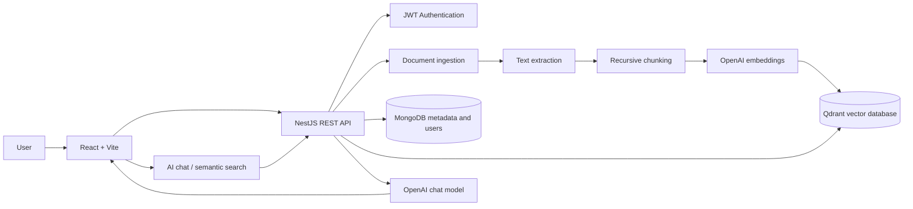

# MindVault — A Personal Vault for Knowledge

MindVault is a personal knowledge assistant MVP. It turns documents into a searchable knowledge base and lets you ask natural-language questions grounded in the content you upload.

> Your knowledge. Your memory. One intelligent vault.

## What it does

- Create an account and sign in with email/password authentication.
- Upload PDF, DOCX, TXT, Markdown, and CSV documents (maximum 20 MB per file).
- Extract text and split it into overlapping, structure-aware chunks.
- Generate embeddings with OpenAI and store vectors in Qdrant.
- Search your documents by meaning, not just exact keywords.
- Ask questions and receive RAG answers with references to retrieved document chunks.
- View and delete documents in your private workspace.

## Architecture



### Technology stack

| Layer | Technology |
|---|---|
| Frontend | React 18, Vite, Lucide React |
| Backend | Node.js, NestJS 10, TypeScript |
| User and document metadata | MongoDB, Mongoose |
| Vector database | Qdrant |
| Embeddings and answer generation | OpenAI API |
| Document extraction | pdf-parse, Mammoth, text/CSV readers |
| API documentation | Swagger / OpenAPI |
| Local infrastructure | Docker Compose |

## Project structure

```text
mindvault-mvp/
├── docker-compose.yml       # MongoDB and Qdrant
├── package.json             # Root convenience scripts
├── README.md
├── frontend/
│   ├── src/App.jsx          # React application
│   ├── src/styles.css
│   ├── .env.example
│   └── package.json
└── backend/
    ├── src/
    │   ├── auth/             # Registration, login, JWT
    │   ├── documents/        # Upload, extraction, chunking, CRUD
    │   ├── ai/               # Embeddings, vector search, RAG chat
    │   ├── common/            # Authentication guard
    │   ├── app.module.ts
    │   └── main.ts
    ├── .env.example
    └── package.json
```

## Prerequisites

- Node.js 20 or newer and npm
- Docker Desktop or Docker Engine with the Compose plugin
- An OpenAI API key with access to the configured chat and embedding models

## Run locally

Run commands from the repository root (`mindvault-mvp/`).

### 1. Start MongoDB and Qdrant

```bash
docker compose up -d
```

The local services expose MongoDB on `27017` and Qdrant on `6333` (HTTP) / `6334` (gRPC).

### 2. Configure the backend

```bash
cd backend
cp .env.example .env
```

Edit `backend/.env` and set at least:

```env
OPENAI_API_KEY=your_openai_api_key
JWT_SECRET=replace_with_a_long_random_secret
```

The remaining defaults are suitable for a local Docker-based setup. See [Backend configuration](#backend-configuration) for all variables.

Install dependencies and start the API:

```bash
npm install
npm run start:dev
```

API: <http://localhost:3000/api>  
Swagger: <http://localhost:3000/api/docs>  
Health: <http://localhost:3000/api/health>

### 3. Configure and start the frontend

Open a second terminal at the repository root:

```bash
cd frontend
cp .env.example .env
npm install
npm run dev
```

Open <http://localhost:5173>.

The frontend uses `VITE_API_URL` to locate the backend. Its default is `http://localhost:3000/api`.

### Root convenience scripts

You can also install both apps from the repository root:

```bash
npm run install:all
```

Then start the backend and frontend in separate terminals:

```bash
npm run dev:api
npm run dev:web
```

Build commands:

```bash
npm run build:api
npm run build:web
```

## First-use walkthrough

1. Start MongoDB, Qdrant, the backend, and the frontend.
2. Open <http://localhost:5173> and create an account.
3. Upload a text-based PDF, DOCX, TXT, Markdown, or CSV file.
4. Wait for the document status to show `indexed`.
5. Open **Semantic search** and search for a concept or question from the document.
6. Open **AI assistant** and ask a question about the uploaded content.
7. Review the source references returned with the answer.

Each account's document queries and vector retrieval are scoped to the authenticated user.

## Backend configuration

All backend settings are read from `backend/.env`.

| Variable | Default | Description |
|---|---|---|
| `PORT` | `3000` | API port |
| `CORS_ORIGIN` | `http://localhost:5173` | Comma-separated allowed frontend origins |
| `MONGODB_URI` | `mongodb://localhost:27017/mindvault` | MongoDB connection string |
| `JWT_SECRET` | — | Secret used to sign JWTs; replace before running |
| `JWT_EXPIRES_IN` | `7d` | JWT lifetime |
| `UPLOAD_DIR` | `./uploads` | Local document upload directory |
| `MAX_FILE_SIZE_MB` | `20` | Document size setting (upload interceptor currently enforces 20 MB) |
| `QDRANT_URL` | `http://localhost:6333` | Qdrant endpoint |
| `QDRANT_API_KEY` | empty | Qdrant Cloud API key, if applicable |
| `QDRANT_COLLECTION` | `mindvault_chunks` | Vector collection name |
| `OPENAI_API_KEY` | — | OpenAI API key |
| `OPENAI_CHAT_MODEL` | `gpt-4o-mini` | Chat completion model |
| `OPENAI_EMBEDDING_MODEL` | `text-embedding-3-small` | Embedding model |
| `EMBEDDING_DIMENSIONS` | `1536` | Vector dimensions; must match the selected embedding model and collection |

Frontend configuration is in `frontend/.env`:

| Variable | Default | Description |
|---|---|---|
| `VITE_API_URL` | `http://localhost:3000/api` | Backend API base URL |

## API overview

Protected endpoints require this header:

```http
Authorization: Bearer <accessToken>
```

| Method | Endpoint | Authentication | Purpose |
|---|---|---|---|
| `POST` | `/api/auth/register` | No | Register an account |
| `POST` | `/api/auth/login` | No | Sign in and receive a JWT |
| `GET` | `/api/health` | No | Health check |
| `POST` | `/api/documents/upload` | Yes | Upload a file as multipart field `file` |
| `GET` | `/api/documents` | Yes | List the current user's documents |
| `GET` | `/api/documents/:id` | Yes | Get document details |
| `PUT` | `/api/documents/:id` | Yes | Update document category |
| `DELETE` | `/api/documents/:id` | Yes | Delete a document and its vectors |
| `POST` | `/api/ai/search` | Yes | Semantic search |
| `POST` | `/api/ai/chat` | Yes | Ask a RAG question |

### Example: semantic search or chat

Both AI endpoints accept a question and optional result count:

```json
{
  "question": "What are the main architecture decisions?",
  "topK": 6
}
```

Example authenticated request:

```bash
curl -X POST http://localhost:3000/api/ai/chat \
  -H "Authorization: Bearer YOUR_TOKEN" \
  -H "Content-Type: application/json" \
  -d '{"question":"Summarize the key points","topK":6}'
```

### Example: upload a document

```bash
curl -X POST http://localhost:3000/api/documents/upload \
  -H "Authorization: Bearer YOUR_TOKEN" \
  -F "file=@./my-notes.pdf"
```

Interactive endpoint documentation is available at <http://localhost:3000/api/docs> while the backend is running.

## How ingestion and RAG work

1. **Upload:** the API receives a supported document and associates it with the signed-in user.
2. **Extract:** text is extracted from the document. Scanned PDFs without an embedded text layer are not OCR-processed.
3. **Chunk:** text is recursively split at paragraph, sentence, newline, and whitespace boundaries. The baseline target is approximately 700 tokens with 100-token overlap.
4. **Embed:** each chunk is converted into a vector using the configured OpenAI embedding model.
5. **Index:** vectors and metadata are stored in Qdrant; document metadata and status are stored in MongoDB.
6. **Retrieve:** a user's search query is embedded and matched against that user's indexed chunks.
7. **Generate:** retrieved passages are supplied to the chat model to produce an answer with source references.

Chunk token counts are estimates based on text length, not exact model tokenization.

## Troubleshooting

- **Frontend says API offline:** check that the backend is running on port `3000` and `VITE_API_URL` is correct.
- **MongoDB connection error:** run `docker compose ps` and confirm the MongoDB container is healthy and port `27017` is available.
- **Qdrant connection error:** confirm the Qdrant container is running and <http://localhost:6333> responds.
- **OpenAI authentication or quota error:** verify `OPENAI_API_KEY`, model access, and account billing/quota.
- **Upload fails or status is `failed`:** inspect the returned document error, verify the file type, ensure it is under 20 MB, and check backend logs.
- **No relevant search results:** confirm the document is `indexed`, contains extractable text, and the query relates to its content.
- **Embedding dimension mismatch:** keep `EMBEDDING_DIMENSIONS` consistent with the embedding model and use a fresh Qdrant collection if changing dimensions.

## Current MVP limitations

This is a development MVP, not a production-hardened service.

- Ingestion is synchronous in the upload request; large documents can take time and there is no durable background queue or retry worker.
- Scanned PDFs and images require an OCR integration, which is not included.
- Chunk sizing uses approximate token counts.
- Chat history is held in the browser session and is not persisted as server-side conversation history.
- The default AI integration uses OpenAI; API usage may incur provider charges.
- Local file storage is used; there is no object-storage integration or malware scanning.
- Production deployment should add stronger rate limiting, email verification, password reset, refresh-token rotation, secure secret management, observability, backups, retention controls, automated tests, and deployment-specific CORS configuration.

## Roadmap ideas

- Background ingestion jobs with progress updates and retries
- OCR for scanned PDFs and image attachments
- Persistent conversations and chat history
- Hybrid keyword + vector retrieval and reranking
- Document summaries and tagging
- Evaluation dataset for retrieval and answer quality
- Automated unit, integration, and end-to-end tests

## Contributing

1. Fork the repository.
2. Create a feature branch.
3. Make focused changes and add tests where possible.
4. Open a pull request with a description of the change.

## License

No license file is currently included. Add a `LICENSE` file before distributing the project under a specific open-source license.

---

**MindVault — A Personal Vault for Knowledge**  
*Turn information into knowledge. Turn knowledge into intelligence.*
